# RAG Ingestion Lab

A small, readable pipeline for learning **multimodal RAG ingestion**: take a PDF with text, tables
and images, turn it into a searchable vector index, and answer questions about it with an agent
that can read the original tables and look at the original images.

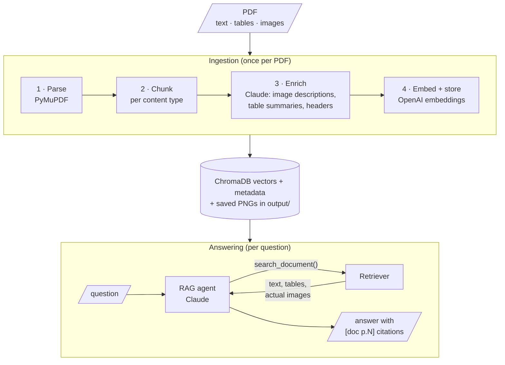

## Setup

```bash
cd rag-ingestion-lab
cp .env.example .env        # then add ANTHROPIC_API_KEY and OPENAI_API_KEY
uv sync
uv run python scripts/make_sample_pdf.py   # creates data/sample_report.pdf
```

- **ANTHROPIC_API_KEY**: Claude Opus 5.5 writes image descriptions and table summaries, and runs the agent. Get one at console.anthropic.com.
- **OPENAI_API_KEY**: `text-embedding-3-small` for embeddings (the same model ad-engine uses).

## Run it

```bash
uv run python -m raglab parse  data/sample_report.pdf           # stage 1 only, no API calls
uv run python -m raglab ingest data/sample_report.pdf           # all four stages
uv run python -m raglab search "Where is the coffee roasted?"   # raw retriever, no LLM
uv run python -m raglab search "revenue" --type table
uv run python -m raglab ask "Which store format should we invest in, and why?"
uv run python -m raglab chat                                    # multi-turn
uv run python -m raglab eval -k 3                               # retrieval hit@k and MRR
```

Use your own PDF the same way: `uv run python -m raglab ingest path/to/file.pdf`. Several PDFs can
live in the same index; each chunk records its `source`.

After ingesting, open **`output/<pdf-name>/report.html`** in a browser. It shows every chunk
exactly as it was embedded, with images inline. Most retrieval bugs are visible there.

## Chatbot (LangGraph + Streamlit)

```bash
uv run streamlit run app.py
```

This opens http://localhost:8501. Attach one or more PDFs with the **+** in the chat box (you can
type a question in the same message), and the chatbot ingests them into the vector database with
live progress for each stage. Then ask questions. Each answer has a **sources** panel showing every
search the agent ran, the hits with their scores, and any retrieved images. The sidebar lists the
indexed PDFs (🗑 removes one), switches Claude enrichment on or off for the next upload, and
starts a new conversation.

The whole chatbot is one LangGraph graph ([raglab/graphs/chat_graph.py](raglab/graphs/chat_graph.py)).
The ingestion pipeline is a second graph ([raglab/graphs/ingest_graph.py](raglab/graphs/ingest_graph.py))
that runs inside it as a subgraph:

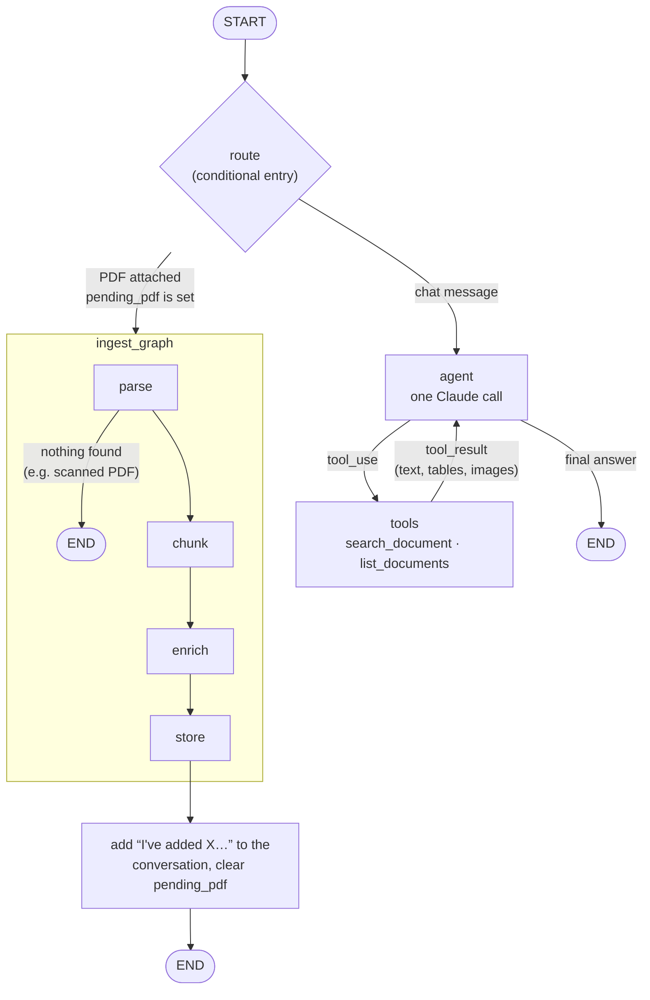

What each LangGraph feature does here:

| LangGraph feature | Where | What it gives you |
|---|---|---|
| `StateGraph` + `TypedDict` state | both graphs | Each node returns only the keys it changes. `messages` and `events` use an `operator.add` reducer, so nodes append to them rather than overwrite. |
| Conditional entry (`add_conditional_edges(START, route, …)`) | chat graph | The same conversation thread handles "here's a PDF" and "answer this question". |
| Conditional edge loop (`agent → tools → agent`) | chat graph | The tool-use loop from `agent.py`, with each step as a separate, inspectable node. |
| Subgraph | `ingest` node calls `ingest_graph` | `graph.stream(..., subgraphs=True)` sends parse/chunk/enrich/store progress to the UI as it happens. |
| Checkpointer (`InMemorySaver`) + `thread_id` | chat graph | Conversation memory: every turn is saved per thread, and **New conversation** just starts a new `thread_id`. Swap in `SqliteSaver` or `PostgresSaver` to keep chats across restarts. |

Messages in the state are kept in the Anthropic API's own format (role + content blocks), so they
go back to Claude unchanged, including thinking blocks. The model calls use the Anthropic SDK
directly from inside the nodes, so no LangChain model wrapper is needed.

You can also drive the graph without the UI:

```python
from raglab.graphs.chat_graph import build_chat_graph

graph = build_chat_graph()
cfg = {"configurable": {"thread_id": "demo"}}
graph.invoke({"pending_pdf": "data/sample_report.pdf", "use_llm": True}, cfg)   # ingest
out = graph.invoke({"messages": [{"role": "user", "content": "Where is the roastery?"}]}, cfg)
print(out["messages"][-1]["content"][-1]["text"])
```

## What each stage does, and why

Each stage writes its result to `output/<pdf-name>/`, so you can open the JSON between stages.

### 1. Parse ([raglab/parse.py](raglab/parse.py)) → `elements.json`, `images/*.png`

A PDF has no paragraphs or tables. It is a list of instructions that place glyphs, lines and
pictures at coordinates. Parsing rebuilds the structure from that layout.

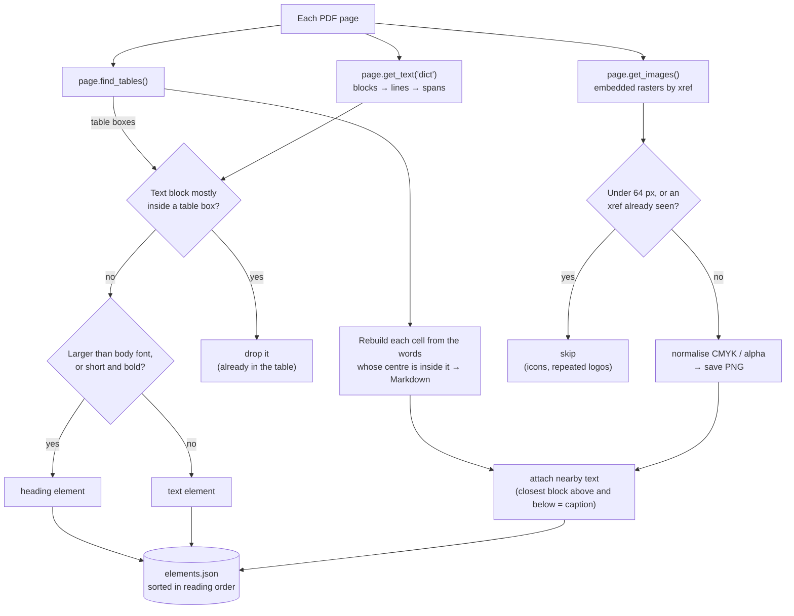

| Content | How it's found | Gotchas you'll meet |
|---|---|---|
| Text | `page.get_text("dict")` gives blocks → lines → spans with font size and flags. Spans larger than the body font, or short bold blocks, are treated as **headings**. | Multi-column layouts, headers/footers repeated on every page, hyphenation |
| Tables | `page.find_tables()` detects grids from ruling lines and text alignment. Each cell is rebuilt from the words whose centre falls inside it. Text inside a table's box is **removed from the text stream** so it isn't indexed twice. | Borderless tables, tables split across pages, merged cells. PyMuPDF's own `to_markdown()` turned "Full year" into "Fullyear", which is why the cells are rebuilt from words. |
| Images | Embedded raster images are found by `xref` and saved as PNG (CMYK and alpha masks are normalised). Images under 64 px are skipped, and an xref is kept only once, so logos and bullets are ignored. | **Vector charts aren't images.** A chart drawn with PDF lines (common in Excel/PowerPoint exports) has no xref. See exercise 3. |

Each table and image also stores its **nearby text**: the closest block above and below, which is
usually the caption ("Figure 2: …").

### 2. Chunk ([raglab/chunk.py](raglab/chunk.py)) → `chunks.json`

A chunk is one retrieval unit, with one vector, returned as one search result. Each content type
is chunked differently:

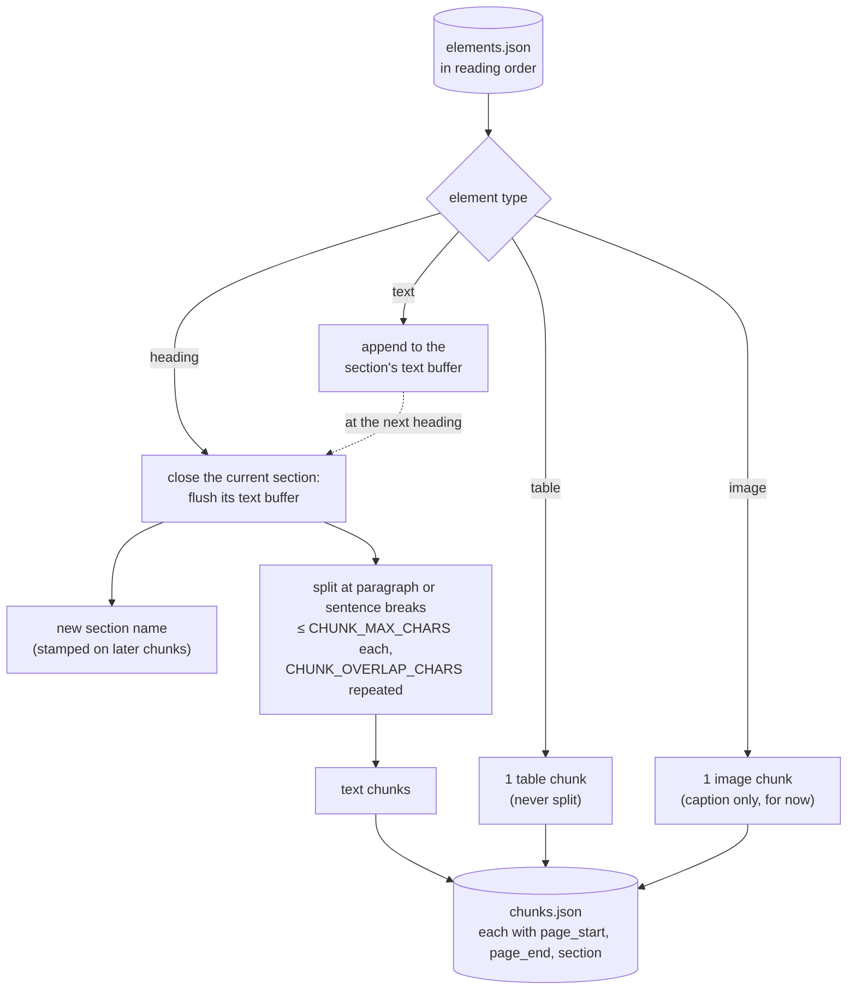

How overlap works on one long section:

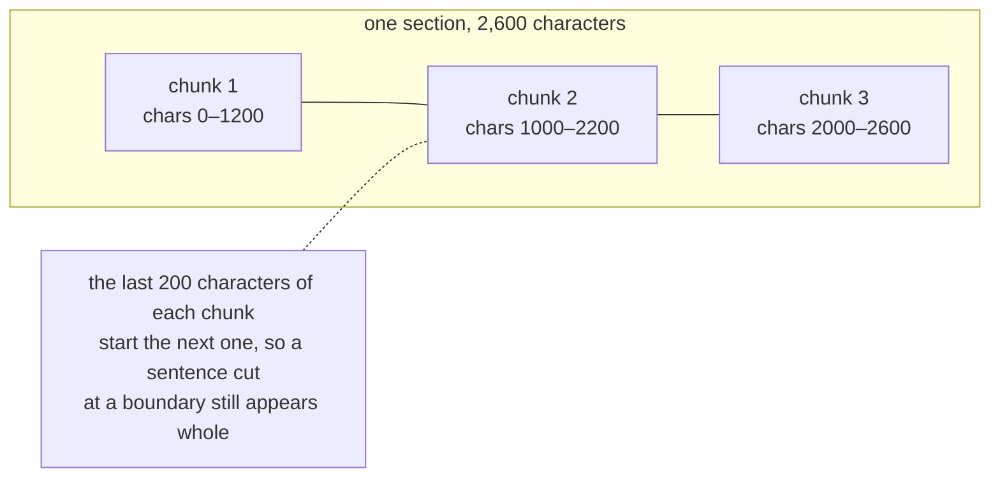

- **Text**: chunks follow sections and never cross a heading, so each chunk stays on one topic. They're capped at `CHUNK_MAX_CHARS` and split at paragraph or sentence boundaries, and each chunk repeats `CHUNK_OVERLAP_CHARS` from the end of the previous one so a sentence cut at a boundary can still be found.
- **Tables**: one chunk per table, never split. Half a table without its header row is useless.
- **Images**: one chunk per image. A text embedding model can't read pixels, so stage 3 fills these chunks in.

Every chunk keeps `page_start`/`page_end` and `section`, which become citations and filters later.

### 3. Enrich ([raglab/enrich.py](raglab/enrich.py)) → `chunks_enriched.json`

Enrichment is what makes this *multimodal* RAG and not just text RAG:

For each content type: what Claude adds, what gets **embedded** (searched), and what the agent
**reads** when the chunk is retrieved. "header" is the contextual header described below.

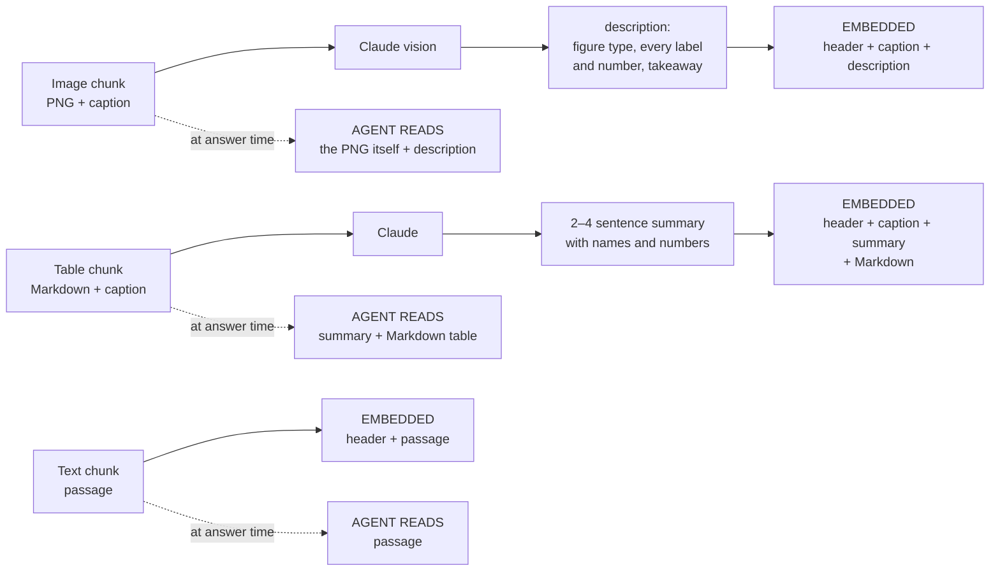

- **Image → description.** Claude looks at each image along with its caption and writes a description for search: the kind of figure, every label and number it can read, and the main takeaway. That text is embedded. The PNG stays on disk and goes to the agent when the image is retrieved. This is the **summary-index / multi-vector** pattern: *search on the summary, answer from the original.*
- **Table → summary.** A raw Markdown table is mostly pipes and digits, which embeds poorly. A 2–4 sentence summary carries the meaning ("Southwest grew fastest…"). The Markdown carries the exact values, and both are stored.
- **Contextual chunk headers.** Every chunk's embedded text starts with `Document / Section / (type, page)`. Without it, a chunk like "It grew 14%" has nothing to match a query about the thing that grew.

LLM results are cached in `output/enrich_cache.json` by content hash, so re-ingesting costs nothing.

### 4. Embed + store ([raglab/store.py](raglab/store.py)) → `output/chroma/`

`embed_text` → 1536-dim vector → ChromaDB row with metadata
(`type, source, page_start, page_end, section, image_path, content, summary`). Re-ingesting a PDF
first deletes that PDF's rows, so you never get duplicates. Chroma runs in-process with no setup.
The same schema maps directly onto **pgvector** in ad-engine: one table with an
`embedding vector(1536)` column plus these metadata columns (exercise 5).

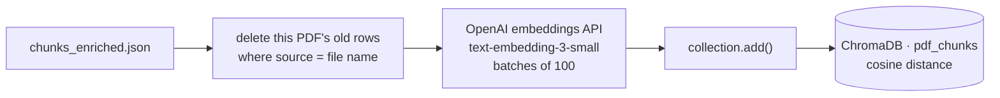

One row in the collection:

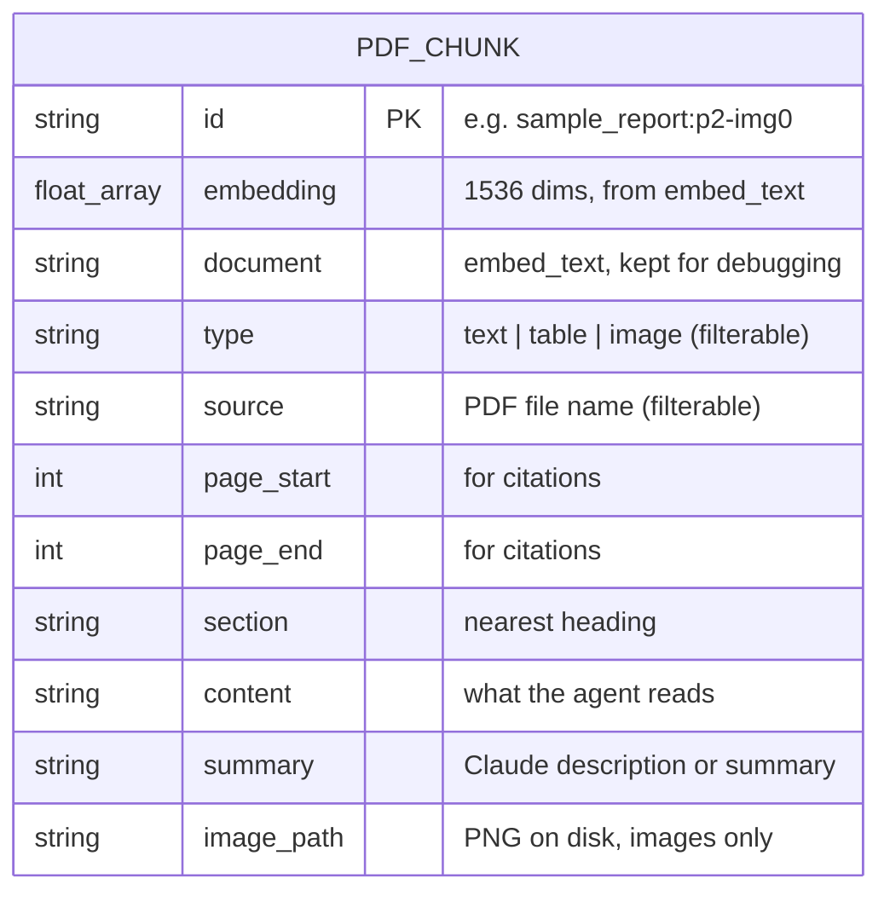

### Retriever ([raglab/retrieve.py](raglab/retrieve.py))

The retriever embeds the query, runs a cosine nearest-neighbour search, and can filter on metadata
(`--type table`). The score is cosine similarity, where higher is closer.

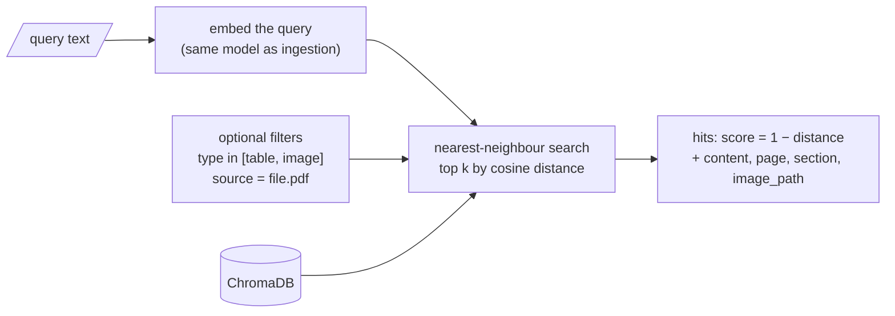

### RAG agent ([raglab/agent.py](raglab/agent.py))

The agent is a hand-written tool-use loop (no framework) so you can see each step. Claude gets one
tool, `search_document(query, content_types?, k?)`, and decides on its own when and what to
search. It can search several times, rephrase, or limit a search to tables or images. **Image hits
come back as real image blocks inside the tool result**, so Claude reads the original chart, not
only the caption written at ingestion time. Answers cite `[file p.N]`.

One question, as it ran on the sample report:

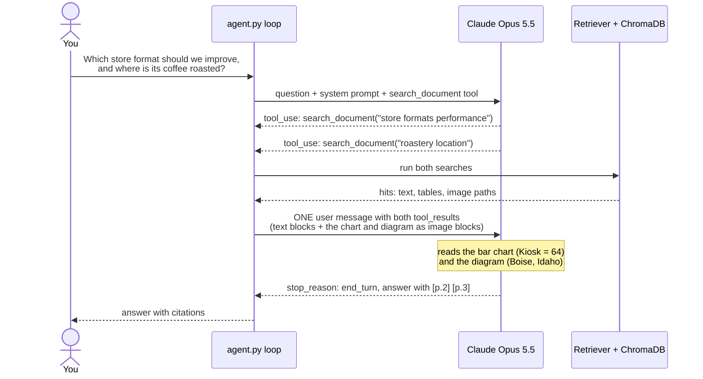

The Claude calls in [raglab/llm.py](raglab/llm.py) use adaptive thinking and opt into
**server-side refusal fallbacks** (`fallbacks="default"`). If a safety classifier declines a
request, the API retries it on a fallback model inside the same call. To turn this off, remove the
`betas`/`fallbacks` arguments in `llm.create`.

## The sample document

`scripts/make_sample_pdf.py` builds a fictional 3-page annual report. Some facts appear in
**only one** format, so you can tell which ingestion path found them:

| Fact | Only in |
|---|---|
| CEO name, 2026 store target | text |
| Q3 Pacific Northwest revenue, Ethiopia fair-trade % | table |
| Satisfaction score per store format | bar chart (image) |
| Roastery city (Boise), warehouse city (Oakland) | diagram (image) |

Try `ask "In which city is the roastery?"` after `ingest --no-llm` and again after a full
`ingest`. Without the image description, the word "Boise" doesn't appear anywhere in the index.

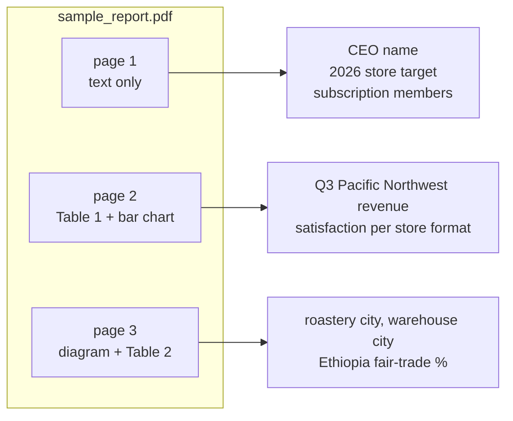

## Measuring changes

`eval` runs the questions in `data/eval_questions.json` through the retriever and checks whether
the chunk that holds each answer comes back, and how high. Use it as a loop:

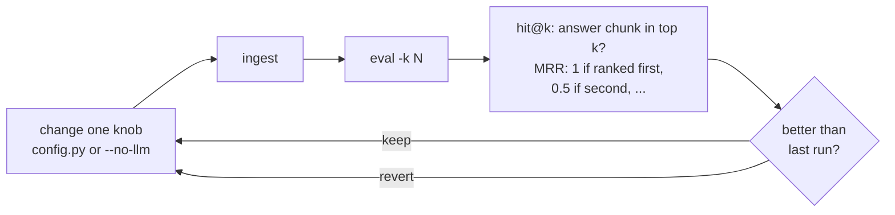

Results on the sample report:

| Run | MRR | hit@3 |
|---|---|---|
| `ingest --no-llm` (captions only) | 0.773 | 1.0 |
| full `ingest` (Claude descriptions and summaries) | 0.864 | 1.0 |

## Exercises

1. **Measure each choice.** Run `eval` after `ingest --no-llm`, then after a full `ingest`. Then change `CHUNK_MAX_CHARS` to 300 and to 3000, and compare hit@k and MRR. (The sample is small, so use `-k 1` or `-k 2` to see differences, or add your own PDF and questions.)
2. **Break the table path.** Run `ingest --no-llm`, then `search` a question worded unlike any table cell ("which market is biggest?"). See how the table summary helps.
3. **Vector charts.** Many real PDFs draw charts as vector graphics. Detect regions with many drawings (`page.get_drawings()`), render them with `page.get_pixmap(clip=rect, dpi=150)`, and treat the result as an image element.
4. **Page screenshots.** Alternatively, render every page to PNG and index a Claude description of each page as a `page` chunk type. Compare that with per-element ingestion on a complex layout.
5. **Move to pgvector.** Re-implement `store.py` against Postgres + pgvector (ad-engine's stack) with `CREATE TABLE chunks (id text primary key, embedding vector(1536), type text, page_start int, ...)` and `ORDER BY embedding <=> $1`.
6. **Hybrid search.** Add BM25 keyword search (e.g. `rank_bm25`) and merge it with the vector results using reciprocal-rank fusion. Exact tokens like "Q3" or "Boise" are where keyword search wins.
7. **Reranking.** Retrieve 20 results, ask Claude to rerank them for the question, and keep the top 5.

## Layout

```
rag-ingestion-lab/
├── raglab/
│   ├── config.py      knobs: models, chunk sizes, thresholds
│   ├── models.py      Element (what the PDF contains) and Chunk (what gets retrieved)
│   ├── parse.py       stage 1
│   ├── chunk.py       stage 2
│   ├── enrich.py      stage 3 (Claude vision + table summaries)
│   ├── store.py       stage 4 (OpenAI embeddings → Chroma)
│   ├── retrieve.py    vector search with metadata filters
│   ├── agent.py       tool-using RAG agent
│   ├── evaluate.py    hit@k / MRR
│   ├── report.py      HTML inspection report
│   ├── __main__.py    CLI
│   └── graphs/
│       ├── ingest_graph.py   LangGraph: parse → chunk → enrich → store
│       └── chat_graph.py     LangGraph: route → ingest | agent ⇄ tools, with memory
├── app.py             Streamlit chatbot (PDF upload + chat)
├── scripts/make_sample_pdf.py
├── data/              PDFs + eval_questions.json (chat uploads go to data/uploads/, gitignored)
└── output/            everything generated (gitignored)
```
